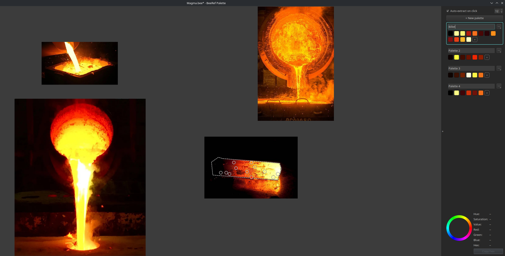

BeeRef Palette
==============

A personal fork of `BeeRef <https://github.com/rbreu/beeref>`_ that builds
color palettes from reference images and exports them as Photoshop ``.aco``
swatches, for any painting app that reads them (Photoshop, Clip Studio
Paint, …).

.. warning::

   **AI-generated changes.** Everything this fork adds on top of BeeRef
   (the palette panel, lasso, extraction, ``.aco`` export, folder
   settings, Space panning and related fixes) was written by an AI
   coding assistant (Claude, by Anthropic) and reviewed by me through
   testing and use, not line by line. Commits made with the assistant
   carry a ``Co-Authored-By: Claude`` trailer. The original BeeRef code
   and its authors are not involved in this fork; please do not report
   issues with it to the BeeRef project.

- Space navigation: hold ``Space`` and drag with the mouse or pen to pan
  the board, like in Photoshop or Clip Studio Paint. Works while drawing a lasso or
  adding points; the tool resumes when you release.
- Palette panel (``P``), collapsible with its chevron. Hidden on the
  welcome screen; on a board it reopens if you left it open (off by
  default).
- Welcome screen: Open board / Add images, and recent boards as tiles
  with a preview and their first palette.
- Menu bar (``M``): the right-click menus at the top of the window.
- Auto-extract on click: distinct dominant colors (3–12) as draggable
  sample points; Regenerate re-extracts from the source image.
- Add points by hand (``A`` or the ``+`` swatch), right-click to remove.
- Lasso region (``L``): click vertices or drag freehand on one image;
  close with a click on the first vertex, a double-click or Enter
  (Backspace removes a vertex, Esc cancels). Extraction then reads only
  that region, and Regenerate reuses it. Plain extraction respects the
  image's crop.
- Merge palettes from the palette's ``⋯`` menu: **Merge with** creates a
  new palette holding copies of both palettes' points (originals kept);
  **Export merged .aco** writes one swatch file without creating a
  palette. With three or more palettes, both offer **All palettes**.
  The default name keeps the names you gave (``Billet`` + ``Palette 2``
  → ``Billet``; ``Billet`` + ``Mood`` → ``Billet + Mood``).
- Read-only inspector with Copy hex.
- Export ``.aco`` (Photoshop swatches), readable by any app that imports
  ``.aco``. Photoshop: Swatches panel menu > Import Swatches. Clip Studio
  Paint: Color Set palette > Import color set.
- Settings > Folders: where boards and ``.aco`` exports are saved by default.

Shortcuts added by this fork
----------------------------

.. list-table::
   :header-rows: 1
   :widths: 30 70

   * - Key / gesture
     - Action
   * - ``Space`` + drag
     - Pan the board (mouse or pen), also while using a tool
   * - ``M``
     - Show / hide the menu bar at the top (View > Show Menu Bar); same
       menus as right-click
   * - ``P``
     - Show / hide the palette panel (View > Palette Panel)
   * - ``Shift+P``
     - New palette
   * - ``A``
     - Add a color point: next click on an image
   * - ``L``
     - Lasso region: extract colors from part of an image
   * - Click / drag (lasso)
     - Add a vertex / draw freehand
   * - Click first vertex, double-click or ``Enter`` (lasso)
     - Close the lasso and extract
   * - ``Backspace`` (lasso)
     - Remove the last vertex
   * - ``Esc`` (lasso, add point)
     - Cancel the tool
   * - Click an image (Auto-extract on)
     - Replace the active palette with that image's colors
   * - Drag a sample point
     - Move it; the swatch color follows
   * - Right-click a point or swatch
     - Remove it
   * - Drag a swatch
     - Reorder the palette
   * - ``Ctrl+Z`` / ``Ctrl+Shift+Z``
     - Undo / redo any palette change

         and four palettes in the side panel

Compatibility: boards are saved as ``.bee`` schema v4. Upstream BeeRef
opens them and keeps palettes on a normal save, but drops them on Save As.

Run with ``make run``, test with ``make test``, install with
``make install`` (Python 3.12 via uv).

----

BeeRef — A Simple Reference Image Viewer
========================================

.. raw:: html

   

`BeeRef <https://beeref.org>`_ lets you quickly arrange your reference images and view them while you create. Its minimal interface is designed not to get in the way of your creative process.

|python-version| |github-ci-flake8| |github-ci-pytest| |codecov| |downloads-total| |downloads-latest|

.. image:: https://github.com/rbreu/beeref/blob/main/images/screenshot.png

.. |python-version| image:: https://github.com/rbreu/beeref/blob/main/images/python_version_badge.svg
   :target: https://www.python.org/

.. |github-ci-flake8| image:: https://github.com/rbreu/beeref/actions/workflows/flake8.yml/badge.svg
   :target: https://github.com/rbreu/beeref/actions/workflows/flake8.yml

.. |github-ci-pytest| image:: https://github.com/rbreu/beeref/actions/workflows/pytest.yml/badge.svg
   :target: https://github.com/rbreu/beeref/actions/workflows/pytest.yml

.. |codecov| image:: https://codecov.io/gh/rbreu/beeref/branch/main/graph/badge.svg?token=QA8HR1VVAL
   :target: https://codecov.io/gh/rbreu/beeref

.. |downloads-total| image:: https://img.shields.io/github/downloads/rbreu/beeref/total.svg
   :target: https://github.com/rbreu/beeref/releases

.. |downloads-latest| image:: https://img.shields.io/github/downloads/rbreu/beeref/latest/total.svg
   :target: https://github.com/rbreu/beeref/releases

Installation
------------

Stable Release
~~~~~~~~~~~~~~

Get the file for your operating system (Windows, Linux, macOS) from the `latest release <https://github.com/rbreu/beeref/releases>`_. The different Linux versions are built on different versions of Ubuntu. The should work on other distros as well, but you might have to try which one works.

**Linux users** need to give the file executable rights before running it. Optional: If you want to have BeeRef appear in the app menu, save the desktop file from the `release section <https://github.com/rbreu/beeref/releases>`_ in ``~/.local/share/applications``, save the `logo <https://raw.githubusercontent.com/rbreu/beeref/main/beeref/assets/logo.png>`_, and adjust the path names in the desktop file to match the location of your BeeRef installation.

**MacOS X users**, look at `detailed instructions <https://beeref.org/macosx-run.html>`_ if you have problems running BeeRef.

Follow further releases via the `atom feed <https://github.com/rbreu/beeref/releases.atom>`_.

Development Version
~~~~~~~~~~~~~~~~~~~

To get the current development version, you need to have a working Python 3 environment. Run the following command to install the development version::

  pip install git+https://github.com/rbreu/beeref.git

Then run ``beeref`` or ``beeref filename.bee``.

Features
--------

* Move, scale, rotate, crop and flip images
* Mass-scale images to the same width, height or size
* Mass-arrange images vertically, horizontally or for optimal usage of space
* Add text notes
* Enable always-on-top-mode and disable the title bar to let the BeeRef window unobtrusively float above your art program:

.. image:: https://github.com/rbreu/beeref/blob/main/images/screenshot.png

Regarding the bee file format
~~~~~~~~~~~~~~~~~~~~~~~~~~~~~

All images are embedded into the bee file as PNG or JPG. The bee file format is a sqlite database inside which the images are stored in an sqlar table—meaning they can be extracted with the `sqlite command line program <https://www.sqlite.org/cli.html>`_::

  sqlite3 myfile.bee -Axv

Options for exporting from inside BeeRef are planned, but the above always works independently of BeeRef.

Troubleshooting
---------------

You can access the log output via *Help -> Show Debug Log*. In case BeeRef doesn't start at all, you can find the log file here:

Windows:

  C:\Documents and Settings\USERNAME\Application Data\BeeRef\BeeRef.log

Linux and MacOS:

  /home/USERNAME/.config/BeeRef/BeeRef.log

Notes for developers
--------------------

BeeRef is written in Python and PyQt6. For more info, see `CONTRIBUTING.rst <https://github.com/rbreu/beeref/blob/main/CONTRIBUTING.rst>`_.
